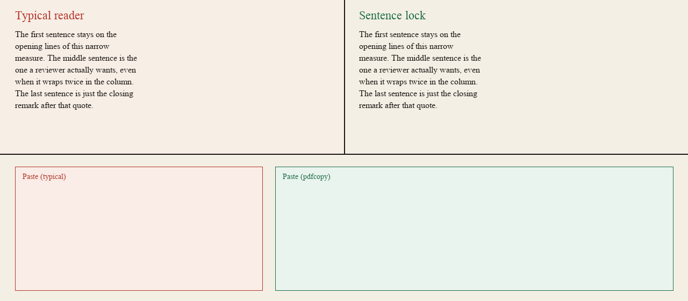

# pdfcopy

[](https://pypi.org/project/pdfcopy/)
[](https://github.com/Ch1rpy2613/pdfcopy/actions/workflows/ci.yml)
[](LICENSE)
[](pyproject.toml)
[](https://github.com/Ch1rpy2613/pdfcopy/stargazers)

**Drag across a wrap. Paste one sentence.**

划过自动折行的那几个字，贴出来是一句完整的话。



A PDF is a stack of “draw these outlines at (x, y)” commands. It does not store sentences. Most readers put a `\n` on the clipboard at every visual wrap, drag in `Page 3 of 12`, and — when ToUnicode is missing — paste `????`.

pdfcopy rebuilds the sentence a person meant to copy, then writes it back as a **copy mesh**: each visible letter gets an invisible twin at the same box, soft wraps become spaces, and each sentence carries `/ActualText`. Offline. No GPU.

## Try it

**No install** — run the demo desk in your browser:

[](https://codespaces.new/Ch1rpy2613/pdfcopy)
then `pdfcopy serve --open` in the Codespace terminal (the port forwards automatically).

**Install the CLI** (Python 3.10+):

```bash
pipx install pdfcopy        # or: pip install pdfcopy
pdfcopy extract contract.pdf
```

**Self-host the demo desk:**

```bash
docker build -t pdfcopy .
docker run --rm -p 8000:8000 pdfcopy
```

Open the demo desk: drag a PDF onto the lit page, or hit the narrow-column sample. Drag across a wrap — amber highlight follows the ink, the note card on the right is the locked sentence. Copy writes `text/plain` and `text/html`. Flip to **断行** for the staircase.

## What it does

- Infers spaces from glyph gaps (many PDFs never write `U+0020`)
- Splits reconstructed paragraphs into sentences (CJK `。！？；`, Latin `.?!` with abbrev/decimal guards)
- Joins soft wraps; keeps list items, tables, and code
- Stitches hyphenated line ends (`inter-` + `national`)
- Drops running heads and `第 3 页 共 12 页`
- Leaves CJK characters unspaced; keeps a space around Latin
- Writes a **glyph-aligned copy mesh** into a standard PDF so other readers’ Ctrl+C can lock a sentence
- Keeps original ink (Artifact-wrapped); `--outline` is optional for readers that ignore Artifact
- Also repairs ToUnicode, a structure tree, and a public [overlay convention](docs/CONVENTION.md)

It does not invent a new format. Acrobat and Preview still open the file. After `pdfcopy fix`, a two-word drag through a wrap pastes the sentence, not five line fragments.

## Commands

```bash
pdfcopy extract paper.pdf           # reconstructed text on stdout
pdfcopy extract paper.pdf --naive   # what most readers copy
pdfcopy extract paper.pdf --page 2
pdfcopy fix paper.pdf -o paper.fixed.pdf
pdfcopy fix paper.pdf -o paper.fixed.pdf --outline   # path-out the original letters
pdfcopy info scan.pdf
```

Scanned pages have no text layer. v1 reports that and stops. It does not OCR.

## Corpus

`corpus/` holds 20 fixtures — invoice, two-column article, contract, Chinese without ToUnicode, scan, fake spaces — each with expected paste text.

Fixture `13-narrow-column` is the proof: typical copy is a staircase plus `Page 1 of 1`; a bbox over the middle sentence pastes that sentence only, with no `\n`.

```bash
python scripts/generate_corpus.py
pytest
python scripts/make_gif.py
```

## 中文说明

**划过自动折行的那几个字，贴出来是一句完整的话。**

PDF 里存的不是句子，而是一串“在坐标 (x, y) 画出这些轮廓”的指令。所以普通阅读器复制出来的是按视觉换行切碎的碎片，还夹带“第 3 页 共 12 页”；缺 ToUnicode 的中文 PDF 甚至只贴得出 `????`。

pdfcopy 从字形坐标重建出你真正想复制的那句话，再以**复制网格（copy mesh）**写回标准 PDF：每个可见字母在同位置获得一个不可见孪生，软换行变成真正的空格，每句话带 `/ActualText`。全程离线、无需 GPU，Acrobat / 预览 / 浏览器照常打开。

它做了什么：

- 从字形间距推断空格（很多 PDF 根本不写 `U+0020`）
- 把重建段落切分成句（中文 `。！？；`，英文 `.?!`，带缩写 / 小数保护）
- 合并软换行；保留列表、表格、代码的原始换行
- 拼接行尾连字符（`inter-` + `national`）
- 去掉页眉页脚和“第 3 页 共 12 页”
- 中文之间不加空格；中西文之间保留空格
- 修复 ToUnicode、补结构树，重建结果按[公开约定](docs/CONVENTION.md)写入 overlay

```bash
pipx install pdfcopy
pdfcopy extract 合同.pdf
pdfcopy serve --open   # 打开本地演示台
```

扫描件没有文本层，v1 只报告、不做 OCR。

## Status

Sentence lock is the product. Merge/split/sign/OCR are someone else’s toolbox.

MIT license.
